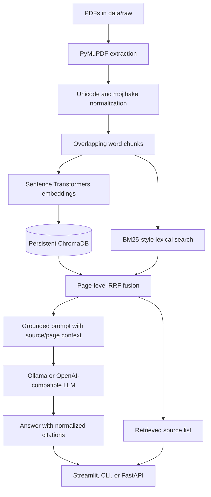

# RAG Documents Assistant

An educational Retrieval-Augmented Generation (RAG) application for asking
questions about a small collection of public PDF documents. The application
extracts and indexes PDF text, retrieves relevant source pages, asks a
configured language model to answer from those passages, and displays the
retrieved source filenames and physical PDF page numbers.

This project is not legal advice. Verify important answers against the
original documents.

## Features

- Extracts selectable text from PDFs with PyMuPDF while preserving the
  original filename and one-based physical page number.
- Normalizes common Unicode and PDF text-extraction mojibake.
- Splits each non-empty page into overlapping word chunks.
- Creates normalized embeddings with
  `sentence-transformers/all-MiniLM-L6-v2`.
- Persists embeddings and metadata in a local ChromaDB collection.
- Combines dense vector retrieval with BM25-style lexical retrieval.
- Fuses candidates at the unique `(source, page)` level with reciprocal rank
  fusion (RRF).
- Applies narrowly scoped exact-phrase evidence for selected domain terms
  without replacing semantic retrieval.
- Generates grounded answers with Ollama by default, or an
  OpenAI-compatible API when configured.
- Normalizes generated citation labels to `[filename, page N]`.
- Provides a Streamlit UI, a command-line question script, and a FastAPI
  endpoint.
- Includes retrieval evaluation, top-20 diagnostics, and pytest coverage for
  ingestion, chunking, retrieval, prompts, and citations.

## Architecture



The main orchestration is in `src/pipeline.py`. PDF parsing is implemented in
`src/ingest/parse_pdf.py`, chunking in `src/ingest/chunker.py`, embedding and
ChromaDB access in `src/index/`, and hybrid retrieval in
`src/retrieval/retriever.py`.

## Repository layout

```text
rag-docs-assistant/
├── app/
│   └── streamlit_app.py       # Streamlit entry point
├── data/
│   ├── raw/                   # input PDFs
│   ├── processed/             # generated one-file-per-page text
│   └── sources.md             # source and usage notes
├── docs/
│   ├── architecture.md
│   └── results.md
├── eval/
│   ├── questions.json         # 40 source-page evaluation cases
│   └── run_eval.py
├── scripts/
│   ├── ask.py                 # command-line question entry point
│   ├── build_index.py         # PDF ingestion and index rebuild
│   └── inspect_retrieval.py   # top-20 retrieval diagnostics
├── src/
│   ├── api/main.py            # FastAPI entry point
│   ├── config.py              # environment-backed settings
│   ├── generation/
│   ├── index/
│   ├── ingest/
│   ├── retrieval/
│   └── pipeline.py
├── storage/chroma/            # generated persistent ChromaDB data
├── tests/
├── .env.example
└── requirements.txt
```

## Prerequisites

- Windows with PowerShell.
- Python 3.10 or 3.11 recommended. The currently verified project
  environment is `.venv-1` with Python 3.14.7.
- Internet access for package installation and the first download of the
  embedding model.
- Four text-based PDFs currently in `data\raw`:
  - `Digital-Personal-Data-Protection-Act-2023.pdf`
  - `NIST.AI.100-1.pdf`
  - `NIST.AI.600-1.pdf`
  - `OWASP-Top-10-for-LLMs-v2025.pdf`
- Ollama and the configured model for local answer generation, or an
  OpenAI-compatible provider and API key.

Scanned PDFs are not supported by the current ingestion script because OCR is
not included.

## Windows PowerShell setup

Open PowerShell in the project root:

```powershell
Set-Location C:\Users\Yaksh\Downloads\rag-docs-assistant
```

If you are creating a new environment, use `.venv`:

```powershell
py -3.11 -m venv .venv
.\.venv\Scripts\Activate.ps1
python -m pip install --upgrade pip
python -m pip install -r requirements.txt
```

If PowerShell prevents activation, allow it only for the current terminal:

```powershell
Set-ExecutionPolicy -Scope Process -ExecutionPolicy Bypass
.\.venv\Scripts\Activate.ps1
```

Activation is optional. Using the interpreter path directly avoids ambiguity
when multiple virtual environments exist. For the verified environment in this
workspace, use:

```powershell
.\.venv-1\Scripts\python.exe -m pip install --upgrade pip
.\.venv-1\Scripts\python.exe -m pip install -r requirements.txt
```

Copy the example configuration before running the application:

```powershell
Copy-Item .env.example .env
```

The application loads `.env` in `src\config.py`. Do not commit `.env` or put
real API keys in documentation.

## Configuration

The supported variables and their defaults are:

```env
LLM_PROVIDER=ollama
OLLAMA_BASE_URL=http://localhost:11434
OLLAMA_MODEL=llama3.2:3b

OPENAI_API_KEY=
OPENAI_BASE_URL=
OPENAI_MODEL=gpt-4o-mini

EMBEDDING_MODEL=sentence-transformers/all-MiniLM-L6-v2
CHUNK_SIZE=450
CHUNK_OVERLAP=80
TOP_K=5
```

`LLM_PROVIDER` must be either `ollama` or `openai`. `TOP_K` controls the
default number of passages returned by the pipeline and UI; the Streamlit
slider can select 1 through 10 for an individual question.

## Ollama setup

Install Ollama using the official installer for Windows, then pull the model
used by the default configuration:

```powershell
ollama pull llama3.2:3b
```

Start Ollama if it is not already running. A typical Windows installation
provides the Ollama service; it can also be started from PowerShell with:

```powershell
ollama serve
```

Leave that process running. Verify the local service and model list:

```powershell
Invoke-WebRequest http://127.0.0.1:11434/api/tags | Select-Object -ExpandProperty Content
ollama list
```

If the service uses a different address, set `OLLAMA_BASE_URL` in `.env`.
The project sends generation requests to
`{OLLAMA_BASE_URL}/api/generate` with `stream=false` and a 180-second
timeout.

### Optional OpenAI-compatible provider

Set `LLM_PROVIDER=openai`, provide `OPENAI_API_KEY`, and set
`OPENAI_BASE_URL` and `OPENAI_MODEL` when required by the provider. The key is
read only from `.env` and is never required for the default Ollama path.

## Index the four PDFs

Confirm the four PDFs are in `data\raw`:

```powershell
Get-ChildItem data\raw\*.pdf
```

From the project root, rebuild the index:

```powershell
.\.venv-1\Scripts\python.exe scripts\build_index.py
```

The equivalent command after activating `.venv` is:

```powershell
python scripts\build_index.py
```

`build_index.py`:

1. Finds every `*.pdf` directly under `data\raw`.
2. Extracts selectable text page by page.
3. Writes generated files such as
   `data\processed\NIST.AI.100-1_page_1.txt`.
4. Chunks the pages using `CHUNK_SIZE` and `CHUNK_OVERLAP`.
5. Deletes and recreates the `rag_documents` ChromaDB collection.
6. Embeds and indexes all chunks in `storage\chroma`.

Because the collection is reset, rerun this command after adding, removing, or
changing PDFs. The verified four-PDF corpus produced 178 non-empty pages and
218 chunks; counts can change if the PDFs change.

## Run the Streamlit application

The correct Streamlit entry point is `app\streamlit_app.py`:

```powershell
.\.venv-1\Scripts\python.exe -m streamlit run app\streamlit_app.py
```

After startup, open the local URL printed by Streamlit, normally
`http://localhost:8501`. Enter a question and click **Ask**. The UI calls
`src.pipeline.answer_question`, retrieves source pages, generates an answer,
and displays the source filename and physical page for each retrieved result.

The app requires an existing index and a reachable/configured LLM. If Ollama
is selected, start it before submitting a question.

## Other entry points

Ask one question from PowerShell:

```powershell
.\.venv-1\Scripts\python.exe scripts\ask.py "What is prompt injection in an LLM application?"
```

Run the FastAPI service:

```powershell
.\.venv-1\Scripts\python.exe -m uvicorn src.api.main:app --reload
```

Then open `http://127.0.0.1:8000/docs`. The API accepts `POST /ask` with a
JSON body containing `question` and an optional `top_k` from 1 through 10.

## Tests and evaluation

Run the complete pytest suite:

```powershell
.\.venv-1\Scripts\python.exe -m pytest -q
```

Run the 40-question source-page evaluation:

```powershell
.\.venv-1\Scripts\python.exe eval\run_eval.py
```

The evaluator reads `eval\questions.json`, retrieves five candidates for each
question, and considers a case a hit only when both the exact source filename
and exact one-based physical page match the expected label. It prints each
hit or miss and the top-five candidates for misses.

Inspect the top 20 candidates for one question:

```powershell
.\.venv-1\Scripts\python.exe scripts\inspect_retrieval.py "What is prompt injection in an LLM application?"
```

### Metric definitions

- **Recall@5**: the fraction of evaluation questions whose expected
  `(source, page)` appears anywhere in the first five retrieved page
  candidates. It measures whether the correct page is retrieved, not whether
  the generated answer is factually correct.
- **MRR (Mean Reciprocal Rank)**: for each hit, uses `1 / rank` of the first
  matching source page and uses zero for a miss; the reported value is the
  mean across all questions. Higher values reward placing the correct page
  earlier.

### Current measured results

The current verified implementation was measured with 40 questions:

| Version | Hits | Misses | Recall@5 | MRR |
|---|---:|---:|---:|---:|
| Original semantic baseline | 27/40 | 13 | 0.675 | 0.397 |
| Dense + substring keyword fusion | 26/40 | 14 | 0.650 | 0.412 |
| Dense + BM25 + page-level RRF | 28/40 | 12 | 0.700 | 0.461 |
| Current phrase-aware fusion | 29/40 | 11 | 0.725 | 0.470 |

The evaluation is retrieval-only. It does not evaluate answer faithfulness,
LLM quality, latency, or citation correctness beyond the retrieved
source-page metadata.

## Demo checklist

Start Ollama, confirm the index exists, and launch Streamlit:

```powershell
ollama list
.\.venv-1\Scripts\python.exe -m streamlit run app\streamlit_app.py
```

In the UI, submit these four smoke-test questions and confirm that the answer
is grounded in the displayed retrieved sources:

1. **DPDP territorial applicability**
   `When does the DPDP Act apply to processing of personal data outside India?`
   Expected focus: Section 3(b), offering goods or services to Data Principals
   within India.
2. **OWASP prompt injection**
   `What is prompt injection in an LLM application?`
3. **NIST AI 600-1 confabulation**
   `How does NIST AI 600-1 define confabulation?`
4. **NIST AI RMF GOVERN**
   `What is the purpose of the GOVERN function in NIST AI RMF 1.0?`

The answer may cite only the passages needed for its claims; the Retrieved
sources section can contain additional retrieved candidates. Check that every
displayed citation uses a filename and page present in the retrieved context.

## Troubleshooting

### `ModuleNotFoundError: No module named 'dotenv'`

Install dependencies with the same interpreter used to run the application:

```powershell
.\.venv-1\Scripts\python.exe -m pip install -r requirements.txt
.\.venv-1\Scripts\python.exe -c "from dotenv import load_dotenv; print('python-dotenv imported')"
```

Do not use `dotenv.__version__`; the package does not expose that attribute.
To inspect the installed distribution version:

```powershell
.\.venv-1\Scripts\python.exe -c "from importlib.metadata import version; print(version('python-dotenv'))"
```

### No PDFs found or no text extracted

Place PDFs directly in `data\raw` and rerun `scripts\build_index.py`. The
current parser handles selectable text only; scanned PDFs require OCR, which
is a future improvement.

### Empty or stale results

Rebuild the index after changing the PDFs:

```powershell
.\.venv-1\Scripts\python.exe scripts\build_index.py
```

The script resets the collection and writes processed page text under
`data\processed`.

### Ollama connection or model error

Check that Ollama is running, the model is installed, and `.env` matches the
service address:

```powershell
ollama list
Invoke-WebRequest http://127.0.0.1:11434/api/tags
```

For a different model, update `OLLAMA_MODEL` and pull that exact model name.

### OpenAI authentication error

Set `LLM_PROVIDER=openai`, provide a valid `OPENAI_API_KEY` in the local
`.env`, and confirm that `OPENAI_MODEL` is supported by the configured
provider. Never paste the key into source files or issue reports.

### PowerShell activation is blocked

Use the process-scoped policy change shown in the setup section, or skip
activation and invoke `.venv-1\Scripts\python.exe` directly.

### Slow first run or model download

The first indexing run downloads the embedding model and may take several
minutes. Later runs use the local model cache but still rebuild the index.
Ollama also loads the selected generation model on demand.

### ChromaDB deprecation warning

The current test run may show a warning from ChromaDB's installed telemetry
dependency about `asyncio.iscoroutinefunction`. It is third-party package
code, not an application import or test failure. Keep dependencies updated
carefully and re-run pytest after upgrades.

### Retrieval misses

Use the evaluator output and the top-20 diagnostic script to inspect source,
page, rank, and distance. Some questions have overlapping concepts across
documents or adjacent pages. The evaluator intentionally uses exact labels;
do not change `eval\questions.json` to improve a score.

## Limitations and future improvements

- OCR for scanned PDFs is not implemented.
- Retrieval quality depends on the embedding model, chunk size, source
  overlap, and the small evaluation set.
- The current evaluator measures source-page retrieval, not answer
  faithfulness or citation entailment.
- The LLM can still produce an incomplete answer when the retrieved passages
  do not contain enough evidence.
- The persistent ChromaDB directory is local application state, not a
  portable database backup.
- The current hybrid ranker is intentionally narrow; a cross-encoder reranker
  or improved query/document weighting could be evaluated separately.
- Future work could add OCR, deduplication, richer evaluation questions,
  automated end-to-end Ollama tests, latency/token logging, and reranker
  experiments.

## Source and usage notes

Keep the original PDFs unchanged and record official source URLs, publishers,
access dates, and usage/license notes in `data\sources.md`. Confirm the
source's redistribution terms before sharing the documents or a built index.
